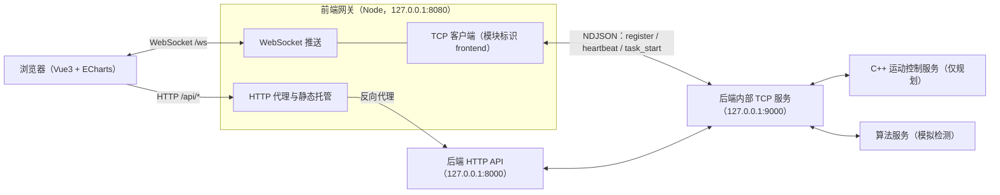
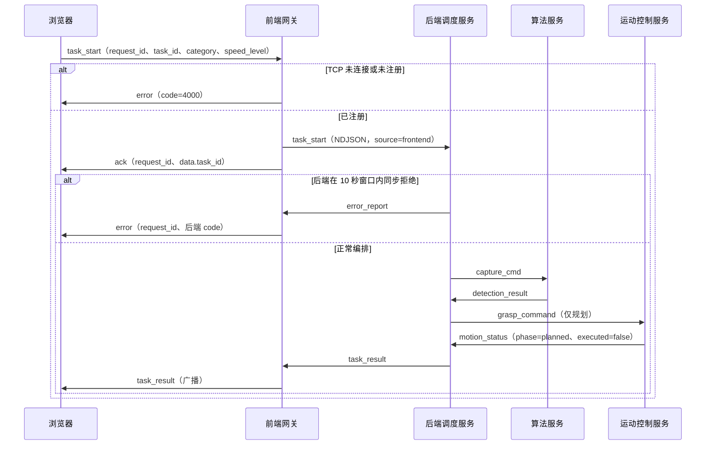

# 前端网关接口

版本：V1.0 ｜ 日期：2026-11-11 ｜ 涉及模块：`frontend/gateway`、`frontend/src`；对 `backend` 只读

## 第 1 章 范围与通信关系

前端网关是浏览器与既有后端调度服务之间的**唯一桥梁**，负责 HTTP 反向代理、WebSocket 推送、
静态页面托管，以及以 TCP 客户端身份注册 `frontend` 模块（注册、心跳、断线重连）。
本层**不修改后端**，也**不直接向 motion 转发控制指令**：规划统一由后端 `RobotService` 下发，
第一阶段仍是 `plan_only`，只返回规划结果，不执行抓取、不推进分拣计数。



* 浏览器只与前端网关同源通信，不直接访问 `127.0.0.1:8000` 或 `127.0.0.1:9000`。
* 前端网关是 TCP **客户端**，后端内部 TCP 服务仍是唯一服务端；`source` 必须与注册身份一致，
  同名 `frontend` 模块已有在线会话时后端拒绝第二条连接（错误码 `3003`）。
* 内部报文遵循 [TCP 通信协议规范](tcp_communication_spec.md)，HTTP 业务语义沿用
  [后端规划网关](backend_gateway.md)；本层只做协议转换与转发，不新增业务能力。
* 第一阶段未提供公网认证或授权服务，默认仅监听本机回环地址。

## 第 2 章 启动方式

### 2.1 环境与依赖

| 组件 | 版本 | 说明 |
| ---- | ---- | ---- |
| Node.js | 24.21.0（最低 ≥ 20.19） | `frontend/package.json` 的 `engines` 约束 |
| npm | 11.19.0 | 依赖安装与脚本执行 |
| 运行依赖 | vue 3.5.45、vue-router 4.6.4、echarts 6.1.0、ws 8.22.2 | 版本由 `frontend/package-lock.json` 锁定 |
| 构建依赖 | vite 8.3.8、@vitejs/plugin-vue 6.0.10 | 仅构建与开发服务器使用 |

### 2.2 常用命令

仓库根目录进入 `frontend/` 后执行：

```powershell
cd frontend
npm install          # 按 package-lock.json 安装已锁定依赖
npm run gateway      # 启动前端网关（HTTP 8080 + WebSocket /ws + 静态托管）
npm run dev          # 启动 Vite 开发服务器（127.0.0.1:5173，代理 /api、/ws 到网关）
npm run build        # 构建静态产物到 frontend/dist
npm test             # 运行前端网关 Node 单元测试
```

开发模式：`npm run gateway` 与 `npm run dev` 各占一个终端，浏览器访问 `http://127.0.0.1:5173`。
生产模式：先 `npm run build`，再由 `npm run gateway` 同源托管 `frontend/dist`，访问
`http://127.0.0.1:8080`。

### 2.3 环境与配置选择

* 环境由 `VISRL_ENV` 控制，取值 `dev` / `sim` / `real`，缺省 `sim`；
  网关读取 `frontend/config/base.json`，再深度合并 `frontend/config/<env>.json`。
* 也可用单文件配置覆盖分级合并结果，入口为 `frontend/gateway/main.mjs`：

  ```powershell
  node gateway/main.mjs --config path/to/gateway_config.json
  node gateway/main.mjs --help
  ```

  单文件模式下配置项 `env` 取自该文件，未提供时记为 `custom`。
* 入口为 `frontend/gateway/main.mjs`：`cd frontend` 后 `npm run gateway` 等价于 `node gateway/main.mjs`；
  在仓库根目录也可直接执行 `node frontend/gateway/main.mjs`。配置与日志路径按入口文件位置推导的
  仓库根目录解析，与当前工作目录无关。
* 启动前会校验配置（`gateway.host` 非空、端口范围、间隔为正数、日志级别合法等），
  非法配置输出明确错误并以退出码 `1` 结束；端口被占用时同样报错退出。
* `deploy/start_frontend.ps1` 封装了 Node 检查、依赖安装、按需构建与端口占用检查，
  用法见 [环境安装与部署指南](../deploy/env_install.md) 第 6、8 章。

## 第 3 章 HTTP 接口

### 3.1 业务代理接口

以下路径由前端网关转发到后端 HTTP API，请求方法与请求体原样透传，后端返回的 HTTP 状态码与
响应体原样返回（含后端统一响应结构）：

| 方法与路径 | 转发目标 | 用途 | 典型成功响应 |
| ---------- | -------- | ---- | ------------ |
| `GET /api/health` | `GET /health` | 后端是否已启动，不代表运动服务在线 | `200`，`data` 为 `{"status":"ok","execution_mode":"plan_only"}` |
| `GET /api/robot/status` | `GET /robot/status` | motion 在线、忙碌状态、当前任务与反馈来源 | `200`，`data` 含 `motion_online`、`busy`、`active_task_id` 等 |
| `POST /api/robot/plan` | `POST /robot/plan` | 提交世界坐标系 TCP 目标，登记规划任务 | `202`，`data.task_id`、`data.status=planning`、`data.task_url` |
| `GET /api/tasks/{task_id}` | `GET /tasks/{task_id}` | 查询 SQLite 中的请求、状态、结果与错误 | `200`，`data.status` 为 `planning/planned/failed/interrupted` |

* `task_id` 段必须非空；查询字符串原样保留。
* 在 `/api` 前缀下，不属于上表的路径或方法与路径不匹配（如 `GET /api/robot/plan`）返回
  `404`、`code=1004`、`msg=接口不存在`。
* `POST /api/robot/plan` 的请求体上限为 1 MiB，超限返回 `413`、`code=1000`。
* 后端错误状态码不经改写，例如 `409`（已有规划任务）、`422`（参数非法）、`500`（内部错误）
  与后端任务错误码一并原样透传，具体字段见 [后端规划网关](backend_gateway.md)。

### 3.2 网关自身接口

| 方法与路径 | 用途 | 返回 `data` 字段 |
| ---------- | ---- | ---------------- |
| `GET /api/gateway/config` | 前端启动时拉取环境与 UI 配置 | `env`、`ui`（`poll_interval_ms`、`default_force_limit`、`categories`、`speed_levels`、`event_log_limit`、`task_history_limit`）、`gateway`（`host`、`port`、`ws_path`）、`backend.http`（`host`、`port`） |
| `GET /api/gateway/status` | 网关与后端连接状态 | `tcp_connected`、`registered`、`backend_online`、`clients`、`last_error` |

* `gateway.host` / `gateway.port` 为实际监听地址；`env` 在 `--config` 单文件模式下可能为 `custom`。
* `backend_online` 与 `registered` 同义，均表示已收到后端 `register_ack`；
  `clients` 为当前在线 WebSocket 客户端数；`last_error` 是最近一次 TCP 连接或 HTTP 代理错误文本，
  无错误时为 `null`（最长保留 512 字符）。
* 两个接口均只接受 `GET`，返回统一响应结构（STYLEGUIDE 4.2）：

```json
{
  "code": 0,
  "msg": "success",
  "data": {},
  "timestamp": 1700000000000
}
```

### 3.3 状态码与错误码

| HTTP 状态 | code | 含义 |
| --------- | ---- | ---- |
| `200` / `202` | 0 | 成功，或后端已接受规划任务 |
| `400` | 1001 | 请求路径非法（静态路径解码或归一化失败） |
| `404` | 1004 | 查询的任务不存在、`/api` 下未知路由，或页面回退时 `index.html` 缺失 |
| `405` | 1000 | 静态资源请求方法不是 `GET` / `HEAD` |
| `409` | 3003 | 后端已有规划任务，不排队、不抢占（后端返回，网关透传） |
| `413` | 1000 | `POST /api/robot/plan` 请求体超过 1 MiB |
| `422` | 1000 | 请求参数非法（后端返回，网关透传） |
| `500` | 3001 | 后端内部异常（透传），或网关自身未捕获异常 |
| `503` | 4000 | 后端不可达、后端内部 TCP 未连接/未注册，或 `frontend/dist` 尚未构建 |
| `504` | 1002 | 代理后端请求超时 |

错误响应同样使用统一结构，`msg` 为可读说明；`code` 取值见
[TCP 通信协议规范](tcp_communication_spec.md) 第 4 章。代理失败时状态接口的 `last_error`
会记录最近一次失败原因。

### 3.4 静态页面托管

* 非 `/api` 开头的路径由网关从 `frontend/dist`（`gateway.static_dir`，相对仓库根）读取并返回，
  按扩展名设置 Content-Type，响应头带 `cache-control: no-cache`。
* 页面路由（SPA）回退：未知的页面路径返回 `dist/index.html`；`index.html` 也不存在时返回
  `404`、`code=1004`。
* `frontend/dist` 目录不存在时返回 `503`、`msg` 提示先执行 `npm run build`。
* 请求路径会先解码并归一化，拒绝目录穿越与含空字节、反斜杠的路径（`400`、`code=1001`）；
  目录路径自动回退到其中的 `index.html`。
* 静态资源只接受 `GET` / `HEAD`。

## 第 4 章 WebSocket 接口

### 4.1 连接与帧格式

* 地址：`ws://127.0.0.1:8080/ws`（路径由 `gateway.ws_path` 配置；开发模式经 Vite 代理同路径）。
* 路径严格匹配：非 `ws_path` 的升级请求返回 `HTTP/1.1 404` 后断开。
* 帧格式：JSON 文本帧，字段 `type` 必填；二进制帧返回 `error`、`code=1001`（仅支持 JSON 文本帧）。
* 单帧上限 `gateway.max_frame_bytes`（默认 1 MiB），超限由 `ws` 库以关闭码 `1009` 断开连接。
* 连接建立后网关立即向该客户端下发一条 `connection` 报文；后端 TCP 连接状态变化时向所有在线客户端
  重新广播 `connection`。
* 广播语义：`task_result` 广播给所有在线客户端；`task_start` 的错误优先只回给发起客户端，
  无法归因或发起客户端已离线时改以 `backend_message` 广播。
* 网关不缓存历史消息：客户端重连后应重新拉取 `/api/gateway/config`、`/api/gateway/status`
  与任务状态，再继续下发任务。

### 4.2 上行报文（浏览器 → 网关）

| type | 字段 | 校验规则 | 失败错误码 |
| ---- | ---- | -------- | ---------- |
| `task_start` | `request_id`（可选，客户端生成，原样回传）、`data.task_id`、`data.category`、`data.speed_level` | `data` 必须为对象；`task_id` 必须为非空字符串且 ≤ 256 字符；`category` 可选、字符串且 ≤ 64 字符；`speed_level` 可选、有限数值 | 非法 JSON / 非对象 `1001`；`data` 非对象、`task_id` 缺失/为空/超长、`category` 或 `speed_level` 非法 `1000`；TCP 未连接/未注册 `4000`；写入失败 `4000` |
| `ping` | 可选 `request_id`、可选 `timestamp` | 只要求 `type` 合法；`request_id` 若提供必须为非空字符串或有限数值 | 非法 JSON `1001`；非法 `request_id` `1000` |

* 未知 `type` 返回 `error`、`code=1000`（`msg` 为「未知报文类型：<type>」）。
* `request_id` 会随 `ack` / `error` 回传，便于前端关联请求；缺失时为 `null`。
* `task_start` 成功转发后网关立即回 `ack`；`ack` 只表示报文已交给后端，**不代表后端业务接受**。
  后端在 10 秒关联窗口内同步拒绝（如 `3003` 已有任务、`4000` 算法离线、`1000` 参数非法）时，
  网关以 `error` 回原请求；超时未收到拒绝则结束关联。
* 网关转发给后端的报文字段为 `data={task_id, category, speed_level}`、`source=frontend`、
  `target=backend`，与协议规范一致；`speed_level` 缺省为 `null`、`category` 缺省为空串。

### 4.3 下行报文（网关 → 浏览器）

所有下行帧都包含 `type`、`code`、`msg`、`data`、`timestamp` 五个字段，其中 `code/msg`
在转发后端报文时取后端原值，其余情况为 `0` / `"success"`。

| type | 额外字段 | 触发时机 |
| ---- | -------- | -------- |
| `connection` | - ；`data` 为 `{tcp_connected, registered, backend_online, client_id}` | 客户端接入时，以及后端 TCP 连接状态变化时 |
| `ack` | `request_id`；`data` 为 `{task_id}` | `task_start` 已写入后端 TCP 连接 |
| `error` | `request_id`（无法解析时为 `null`）；`data` 为后端关联错误时的附加数据（无则 `{}`） | 报文校验失败、TCP 未连接、发送失败、后端在关联窗口内拒绝任务 |
| `task_result` | - ；`data` 为后端 `task_result` 的 `data` 原样内容（`task_id`、`sorted_count`、`is_finished`、`phase`、`executed`、`planning_task_id`、`error`） | 后端推送 `task_result` 时广播给所有客户端 |
| `backend_message` | `msg_type`、`source`、`target` | 后端发往前端但未能关联到具体 `task_start` 的报文（如 `error_report`），或其它后端报文 |
| `pong` | `request_id`（回显客户端请求值，未提供时为 `null`） | 收到客户端 `ping` |

`task_result` 的 `sorted_count` 只有在真实执行回传 `phase=placed` 后才会推进；当前第一阶段
运动控制服务仅规划，规划成功不会增加计数，前端不得把 `phase=planned` 展示为分拣完成。

### 4.4 task_start 典型时序（plan_only）



### 4.5 断线与重连

* 网关 ↔ 后端 TCP：注册成功后每隔 `gateway.heartbeat_interval_sec`（默认 3 秒）发送 `heartbeat`；
  超过 `gateway.heartbeat_timeout_sec`（默认 10 秒）未收到任何后端报文即断开并按
  `gateway.reconnect_intervals_sec`（默认 `[1,3,5]`，用尽后保持 5 秒）重连，进程不退出。
* 注册被后端拒绝（如重复 `frontend` 模块 `3003`）时只记录 `WARN` 与 `last_error`，随后按同样间隔退避重连。
* 浏览器 ↔ 网关：WebSocket 断线重连由前端界面层实现（1s/3s/5s 递增），网关侧不缓存离线消息。

## 第 5 章 配置项

`frontend/config/base.json` 为公共基础配置，`dev.json` / `sim.json` / `real.json` 按环境覆盖：

| 配置项 | 默认值 | 说明 |
| ------ | ------ | ---- |
| `gateway.host` / `gateway.port` | `127.0.0.1` / `8080` | 网关 HTTP 与 WebSocket 监听地址 |
| `gateway.ws_path` | `/ws` | WebSocket 路径，必须以 `/` 开头 |
| `gateway.api_prefix` | `/api` | HTTP 代理前缀，浏览器看到的接口路径 |
| `gateway.static_dir` | `frontend/dist` | 静态托管目录，相对仓库根解析 |
| `gateway.max_frame_bytes` | `1048576` | WebSocket 单帧与 TCP 接收缓冲上限（1 MiB；TCP 侧按字符数近似判断） |
| `gateway.heartbeat_interval_sec` | `3` | 网关向 backend 发送 `heartbeat` 的间隔（秒） |
| `gateway.heartbeat_timeout_sec` | `10` | 超过该时长未收到后端报文即判定断线（秒），与协议规范一致 |
| `gateway.reconnect_intervals_sec` | `[1, 3, 5]` | 网关到 backend 的 TCP 重连间隔（秒），用尽后保持最后一项 |
| `gateway.send_timeout_sec` | `3` | TCP 发送超时与 HTTP 代理超时（秒），代理超时按错误码 `1002` 处理 |
| `gateway.log_level` | `INFO` | 日志级别（`dev.json` 覆盖为 `DEBUG`） |
| `gateway.log_file` | `logs/frontend/gateway.log` | 网关日志文件，相对仓库根解析 |
| `backend.http.host` / `backend.http.port` | `127.0.0.1` / `8000` | 后端 HTTP API 地址 |
| `backend.tcp.host` / `backend.tcp.port` | `127.0.0.1` / `9000` | 后端内部模块 TCP 地址 |
| `ui.poll_interval_ms` | `2000` | 前端轮询周期（`dev.json` 覆盖为 `1000`） |
| `ui.default_force_limit` | `5.0` | 前端规划表单默认夹持力（牛顿） |
| `ui.categories` / `ui.speed_levels` | `apple/pear/tomato/orange`、`1/2/3` | 分拣品类与速度等级下拉项 |
| `ui.event_log_limit` / `ui.task_history_limit` | `200` / `20` | 前端事件日志与本地任务历史上限 |

* `ui` 段不参与网关业务逻辑，仅通过 `GET /api/gateway/config` 提供给前端。
* `real` 环境目前只影响配置取值，后端与 C++ 运动控制服务在 real 模式下仍明确拒绝启动。

## 第 6 章 日志

* 网关日志同时输出到控制台与 `gateway.log_file`（默认 `logs/frontend/gateway.log`），
  单行格式为 `时间 | 级别 | 模块 | 内容`，按 1 MiB 轮转、保留三份历史文件；
  日志目录不可写时降级为仅控制台输出并在控制台提示一次。
* 启动时打印运行环境、监听地址与 WebSocket 路径、静态资源目录、后端 HTTP/TCP 目标与连接状态；
  运行期记录 TCP 注册/重连、WebSocket 客户端接入/断开、任务转发、代理失败等。
* 非法 TCP 帧只记录 `WARN` 并丢弃，不中断连接。
* `deploy/start_frontend.ps1` 会把网关标准输出与错误输出分别重定向到
  `logs/frontend.stdout.log`、`logs/frontend.stderr.log`。
* 网关在收到 `SIGINT` / `SIGTERM` 时依次关闭 WebSocket 客户端、TCP 连接与 HTTP 服务，
  正常退出码为 `0`；配置或启动失败退出码为 `1`。

## 第 7 章 测试命令

```powershell
# 前端网关 Node 单元测试（协议编解码、配置合并、TCP 客户端、WebSocket 会话、HTTP 代理与静态托管）
cd frontend
npm test

# Python 集成测试：假后端 + 真实网关子进程（仓库根目录执行）
./.venv/Scripts/python.exe -m unittest tests.integration.test_frontend_gateway -v

# 全链路 e2e：真实后端 + 真实 C++ 规划服务 + 前端网关
./.venv/Scripts/python.exe -m unittest tests.e2e.test_frontend_full_loop -v
```

`npm test` 等价于 `node --test ../tests/unit/frontend/*.test.mjs`，在 `frontend/` 目录下执行。
Python 用例使用仓库 `.venv`；e2e 依赖已构建的 `motion_control.exe`，缺失时用例跳过而不是失败。
「后端同步拒绝 `task_start` → 定向 `error`」路径由 Node 单元测试覆盖（零/单/多 pending 三态）；
Python 侧未单独覆盖该路径，真实后端联调时需人工确认 `request_id` 回填正确。

## 第 8 章 已知边界与限制

* **仅本机监听**：默认绑定 `127.0.0.1`，未提供公网认证、授权、限流、CORS 或 TLS 终止；
  对外部署需另加反向代理与访问控制。
* **不执行抓取**：第一阶段后端与运动控制服务均为 `plan_only`，`executed=false`；
  `sorted_count` 只在真实执行回传 `phase=placed` 后推进，前端不得把规划成功展示为分拣完成。
* **不做业务校验**：参数合法性、规划占用与任务状态以后端为准；网关只做传输层与报文结构校验。
* **单实例约束**：同一后端只允许一个在线的 `frontend` 模块；重复启动网关会收到 `3003` 并退避重连。
* **注册阶段无独立超时**：TCP 已连接但后端未在合理时间内回 `register_ack` 时，网关不会主动断开；
  当前后端实现必定回 `register_ack`、`error_report` 或断开连接，风险较低，后续加固项为增加注册超时。
* **本机安全边界**：未校验 WebSocket `Origin` / `Host`（无认证、仅回环监听，且当前 `plan_only`
  不执行实际抓取）；对外部署前需增加 Origin/Host 白名单与认证。
* **代理范围固定**：仅代理第 3.1 节列出的四个业务接口，不做任意路径透传；请求头只透传
  `content-type` 与 `content-length`，不代理 Cookie / 认证头。
* **静态托管不含构建**：网关只托管 `frontend/dist`，不会自动构建；缺失时以 `503` 提示。
* **无消息回放**：WebSocket 不保存离线消息，也没有消息队列；重连后由前端重新拉取状态；
  `task_start` 的后端拒绝关联窗口固定 10 秒，超时后的错误以 `backend_message` 广播。
* **单帧与报文上限**：WebSocket 单帧 1 MiB（超限断开），HTTP 规划请求体 1 MiB（超限 `413`），
  任务标识 `task_id` 最长 256 字符。
