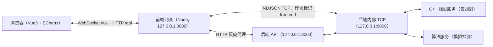
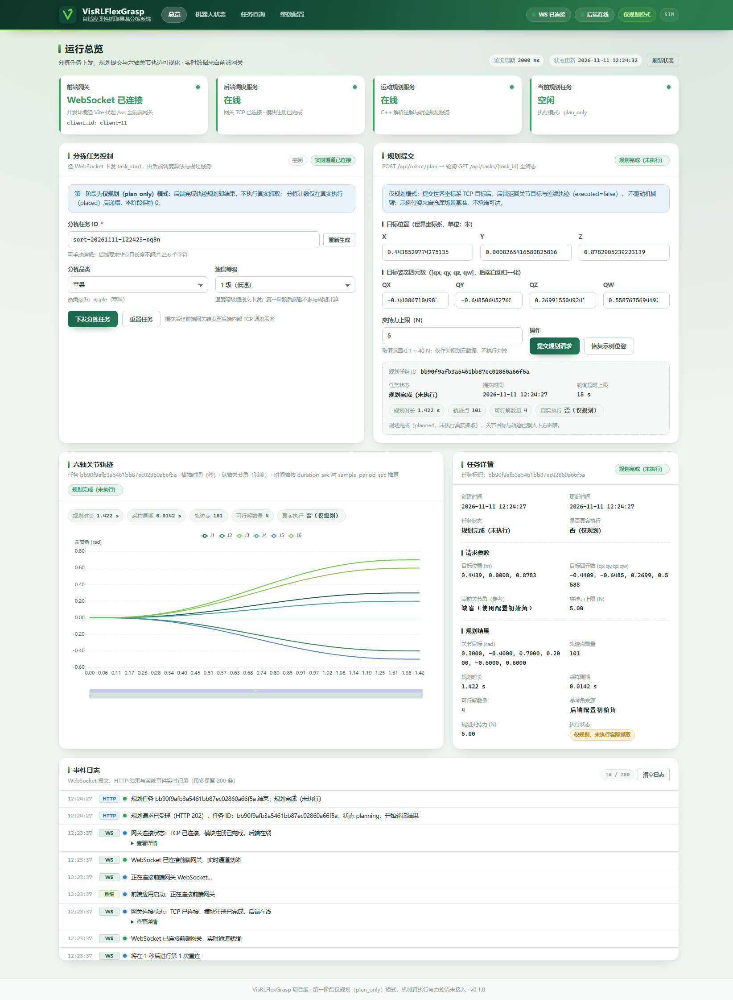
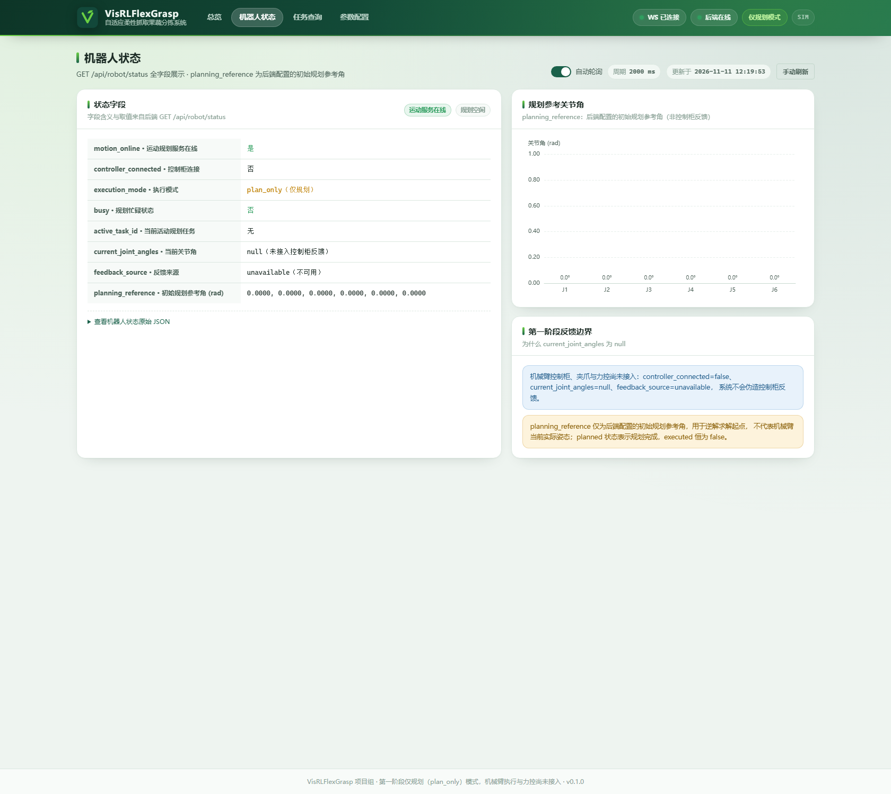
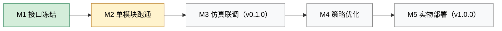

# 项目进度评估（2026-11-11）

版本：V1.0 ｜ 日期：2026-11-11 ｜ 评估对象：前端交互层并入后的仓库工作区

## 第 1 章 结论摘要

* 项目已越过 **M1 接口冻结**，**M2 单模块跑通**基本完成，当前处于 **M2 与 M3 之间**：
  各模块可独立运行、模块间规划链路已端到端打通，但 **M3 仿真全链路分拣闭环尚未达成**，
  `v0.1.0` 未打 Tag。
* 本轮新增**前端交互层**：Node 前端网关（HTTP 反向代理 + WebSocket 推送 + 静态托管）与
  Vue3 + ECharts 可视化界面，补齐 M2 路线图中「前端静态页面」一项。
  浏览器侧已具备任务下发、规划提交、状态查询与参数配置能力，**链路止于规划**，
  不包含真实抓取执行。
* 主要缺口集中在执行层与算法真实化：CoppeliaSim 执行驱动、夹爪/力控、`phase=placed`
  执行反馈与分拣计数推进均未实现；真实 YOLOv8 推理与 RL 策略仍走模拟/几何降级路径。
* 本文结论依据仓库代码、`docs/` 既有文档与本轮实际运行的测试命令；未验证内容在文中标注，
  不把「接口已就绪」等同于「功能已实现」。

## 第 2 章 已完成交付

### 2.1 分层完成情况

| 模块 | 主要交付物 | 状态 | 验证或依据 |
| ---- | ---------- | ---- | ---------- |
| common | NDJSON 报文构建/解析/校验、全局错误码、分级配置加载、日志工具 | 已完成 | `common/protocol.py`、`common/config_loader.py`、`common/log_util.py`；与 [TCP 通信协议规范](../api/tcp_communication_spec.md) 一致；单元测试 10 项通过 |
| backend | HTTP API 4 个接口（`127.0.0.1:8000`）、内部 NDJSON TCP 服务（`127.0.0.1:9000`）、SQLite 任务记录、单实例文件锁、`plan_only` 规划网关 | 已完成（第一阶段） | [后端规划网关](../api/backend_gateway.md)、`backend/app/`、`backend/comm/`、`database/schema/robot_tasks.sql` |
| embedded | C++17 运动学库（定制 UR5 解析逆解、正解回代校验、关节轨迹规划）与 TCP 规划服务 | 已完成（仅规划） | `embedded/motion/`、`embedded/comm/`、[定制 UR5 模型与解析逆运动学](custom_ur5_ik.md)；CTest 3/3 通过 |
| algorithm | 算法服务：消费 `capture_cmd`、回报 `detection_result`；模拟检测器 + 几何默认抓取策略降级 | 已完成（模拟） | `algorithm/algorithm_service.py`、`algorithm/vision/fruit_detector.py`、`algorithm/inference/grasp_policy.py`；`use_mock=true` |
| database | `robot_tasks` 单表（任务 ID、状态、请求/结果/错误 JSON、时间戳） | 已完成 | `database/schema/robot_tasks.sql` |
| tests | 单元测试、集成测试与 UR5 场景位姿 fixtures；C++ 侧接入 CTest | 基线已建立 | `tests/unit/`、`tests/integration/`、`tests/fixtures/`、`embedded/CMakeLists.txt` |

### 2.2 测试基线（2026-11-11 实际运行）

| 测试集 | 命令 | 本轮结果 |
| ------ | ---- | -------- |
| C++ 数学、处理器与 TCP 集成 | `ctest --test-dir embedded/build -C Release --output-on-failure` | 3/3 通过（`motion_math`、`motion_processor`、`motion_tcp_integration`） |
| Python 单元测试 | `./.venv/Scripts/python.exe -m unittest discover -s tests/unit -v` | 10 项通过 |
| Python 集成测试（本轮新增前端网关用例） | `./.venv/Scripts/python.exe -m unittest tests.integration.test_frontend_gateway -v` | 11 项通过（约 23 秒） |
| 既有集成测试集 | `./.venv/Scripts/python.exe -m unittest discover -s tests/integration -v` | 17/18 通过：`test_backend_gateway.py` 13/14（1 项挂起，见第 2.4 节）、`test_motion_service.py` 3/3、`test_full_loop.py` 1/1；排除挂起用例后全量（含本轮新增 11 项）共 28 项通过 |
| 前端交互层全链路 e2e | `./.venv/Scripts/python.exe -m unittest tests.e2e.test_frontend_full_loop -v` | 1 项通过 |
| 前端网关 Node 单元测试 | `cd frontend; npm test` | 102 项通过（2026-11-11 实跑） |

### 2.3 集成测试覆盖范围

`tests/integration/` 已覆盖：后端 HTTP + 真实内部 TCP + SQLite 的第一阶段验收
（`test_backend_gateway.py`）、C++ 规划服务注册与规划回复（`test_motion_service.py`）、
旧版纯模拟分拣全链路（`test_full_loop.py`）。本轮前端交互层新增的网关链路测试见第 3.3 节，
测试总入口与运行命令见 [前端网关接口文档](../api/frontend_gateway.md) 第 7 章。

### 2.4 已知测试问题（预存，非本轮引入）

`tests/integration/test_backend_gateway.py` 的
`TestBackendGateway.test_identity_bypass_and_duplicate_registration` 在 Python 3.12.4 下会
**永久挂起**，导致整个 `tests/integration` 目录的 `discover` 无法一次跑完。定位结论为
`asyncio.Server.wait_closed` 语义与 `backend/comm/tcp_server.py` 的 `close()` 关闭顺序不匹配，
可稳定复现 3 次，**与本轮前端交互层改动无关**；改用单文件/单用例隔离运行后，其余 17 项与
本轮新增 11 项全部通过。该问题涉及既有后端代码或既有测试调整，不在本轮写作用域，
待项目负责人裁决修复方案后在相应任务中处理，本文不作「集成测试全绿」的结论。

## 第 3 章 本轮新增：前端交互层

### 3.1 新增链路

前端网关只做协议转换、代理与推送，**不修改后端**，也不直接向 motion 转发控制指令；
规划仍统一由后端 `RobotService` 下发，整个链路 `executed=false`。

### 3.2 新增交付物

| 交付物 | 内容 | 状态 |
| ------ | ---- | ---- |
| `frontend/gateway/` | Node 前端网关：`/api/*` 反向代理、`/api/gateway/config`、`/api/gateway/status`、静态托管 `frontend/dist`（SPA 回退）、WebSocket `/ws`、TCP `frontend` 模块注册/心跳/重连 | 本轮新增，契约见 [前端网关接口文档](../api/frontend_gateway.md) |
| `frontend/src/` | Vue3 + ECharts 界面：总览看板、机器人状态、任务查询、参数配置；HTTP/WS 客户端与断线重连 | 本轮新增 |
| `frontend/config/` | `base/dev/sim/real` 四级配置：网关、后端地址与 UI 参数 | 本轮新增 |
| `deploy/start_frontend.ps1` | 前端网关一键启动（Node 检查、依赖安装、按需构建、端口占用检查、日志） | 本轮新增，用法见 [环境安装与部署指南](../deploy/env_install.md) |
| `docs/api/frontend_gateway.md` | 前端网关 HTTP/WebSocket 对外契约、时序与配置说明 | 本轮新增 |

### 3.3 新增测试

| 测试 | 位置 | 说明 | 2026-11-11 结果 |
| ---- | ---- | ---- | --------------- |
| 前端网关 JS 单元测试 | `tests/unit/frontend/`（`cd frontend && npm test`） | 协议编解码、配置合并、TCP 客户端、WebSocket 会话、HTTP 代理与静态托管 | 102 项通过 |
| 前端网关 Python 集成测试 | `tests/integration/test_frontend_gateway.py` | 假后端 + 真实网关子进程：注册、心跳、`task_start`、`task_result` 推送、代理与静态托管 | 11 项通过 |
| 全链路 e2e | `tests/e2e/test_frontend_full_loop.py` | 真实后端 + 真实 C++ 规划服务 + 前端网关的规划闭环 | 1 项通过 |

### 3.4 界面示例

以下截图来自本机实际运行（真实后端 + 模拟算法 + 真实 C++ 规划服务 + 前端网关，规划态
`executed=false`）；示例中「规划完成（未执行）」与「是否真实执行：否（仅规划）」即为当前
`plan_only` 阶段的界面语义。

## 第 4 章 未完成事项与风险

| 事项 | 当前状态 | 影响 | 前置条件 |
| ---- | -------- | ---- | -------- |
| CoppeliaSim 仿真执行驱动 | 未开始：C++ 服务仅做解析逆解与轨迹规划，不连接仿真场景 | 无 `motion_status(phase=placed)` 反馈，分拣计数不推进，前端看不到真实执行过程 | 按 [技术选型](tech_selection.md) 接入 CoppeliaSim ZMQ Remote API，先验证场景加载与关节句柄 |
| 夹爪与柔性力控 | 未开始：`force_limit` 仅作为规划元数据校验 | 无法验证柔性抓取效果与破损率，项目核心卖点缺实测数据 | 执行驱动完成，RG2 夹爪接口接入 |
| 真实 YOLOv8 视觉 | 未开始：`FruitDetector` 走模拟检测（3 个目标递减） | 目标检测与位姿不真实，算法层数据为构造值 | 数据集与权重外部存储分发（>10MB 不入库），深度相机图像链路 |
| RL 策略训练与推理 | 未开始：`GraspPolicy` 降级为几何默认策略 | 抓取姿态与夹持力无学习效果，M4 无训练产物 | Gymnasium 仿真环境、SB3 PPO 训练脚本与评估报告 |
| 前端 3D 展示 / Laya | 未开始：当前仅 2D 图表、表格与事件日志 | 演示效果与答辩展示受限 | 执行反馈数据可用后再接 3D 场景 |
| M3 一键仿真联调 | 未完成：`deploy/start_sim.ps1`（后端 + 算法）与 `deploy/start_frontend.ps1`（前端网关）分别可用，C++ 服务仍需手动构建启动，无统一总控脚本 | 联调步骤多、易漏启动顺序；M3 验收条件不满足 | 执行驱动完成后编排全链路启动与健康检查 |
| `v0.1.0` 打 Tag | 未完成 | M3 里程碑未标记，无版本说明与 Demo 视频 | M3 验收通过后按 STYLEGUIDE 5.5 执行 |
| 文档债 | `README.md` 仍有占位内容与失效链接（`./docs/STYLE GUIDE.md` 路径含空格、`./docs/env_install.md` 实际为 `docs/deploy/env_install.md`）；`env_install.md` 第 2、4、7 章仍为「待补充」 | 影响新成员上手与结题文档质量 | 各模块落地后统一修订 |
| `deploy/start_sim.ps1` 编码兼容 | 既有脚本为 UTF-8 无 BOM，在本机 Windows PowerShell 5.1 下解析中文报 3 处语法错误；改用 PowerShell 7 可执行（预存问题，本轮未改动该文件，已在环境文档第 8 章记录） | 一键启动脚本在 PS 5.1 下不可用，需手动启动后端与算法服务或使用 PS 7 | 后续 bugfix 分支为脚本加 UTF-8 BOM 或统一约定 PS 7 |
| 既有集成用例挂起（预存问题） | `test_identity_bypass_and_duplicate_registration` 在 Python 3.12.4 下永久挂起（`asyncio.Server.wait_closed` 与 `backend/comm/tcp_server.py` 的 `close()` 关闭顺序不匹配，稳定复现，与本轮前端改动无关） | `tests/integration` 整目录 `discover` 无法一次跑完，CI 需按文件/排除该用例运行 | 由项目负责人裁决：修改既有后端关闭顺序或调整既有测试；不在本轮写作用域 |

## 第 5 章 里程碑对照（M1–M5）

| 里程碑 | 目标（[优化方案](project_optimization_plan.md) 4.1） | 当前判定 | 依据 |
| ------ | --------------------------------------------------- | -------- | ---- |
| M1 接口冻结 | 全局通信协议与错误码定义完成 | 已完成 | [TCP 通信协议规范](../api/tcp_communication_spec.md) 第 2、4 章与 `common/protocol.py` 一致；前端网关 HTTP/WebSocket 契约见 [前端网关接口文档](../api/frontend_gateway.md) |
| M2 单模块跑通 | 算法离线推理 demo、C++ 连通 CoppeliaSim、后端 TCP 服务、前端静态页面 | 基本完成 | 后端 TCP/HTTP 服务可用；前端界面本轮新增且 `npm run build` 构建通过；算法为模拟推理 demo；C++ 已能解析场景模型并规划，但**尚未与 CoppeliaSim 运行时连通** |
| M3 仿真联调（v0.1.0） | 仿真环境全链路分拣闭环、一键启动、Demo 视频、打 Tag | 未完成 | 浏览器 → 前端网关 → 后端 → C++ 规划链路已由 e2e 用例验证可跑通（规划态），但缺执行反馈与分拣计数，不构成闭环；统一一键启动与 Demo 未交付 |
| M4 策略优化 | RL 策略训练收敛、降级策略验证 | 未开始 | 仅有几何默认降级策略，无训练脚本、无评估报告 |
| M5 实物部署（v1.0.0） | `enable_hardware` 切换实体硬件验收 | 未开始 | `VISRL_ENV=real` 在后端与 C++ 服务中均明确拒绝启动，第一阶段不接控制柜 |

## 第 6 章 下一步建议

1. **优先打通执行链路（M3 关键路径）**：按技术选型接入 CoppeliaSim ZMQ Remote API，
   实现执行适配器并回传 `motion_status(phase=placed, is_success=true)`；
   只有 `placed` 才推进后端分拣计数，禁止规划器虚报执行结果。
2. **补齐一键仿真联调**：在现有 `deploy/start_sim.ps1` 与 `deploy/start_frontend.ps1` 基础上
   增加 C++ 规划服务构建/启动与健康检查，形成 M3 验收脚本；统一 `logs/` 日志与端口检查。
3. **前端增强**：接入执行阶段、分拣计数与夹爪状态展示；3D/Laya 展示排在执行链路可用之后，
   避免展示层先于数据层返工。前端交互层自身的后续加固项：
   - 网关在 TCP 注册阶段增加独立超时，避免后端异常时不重连（当前后端必定应答或断开，风险低）；
   - WebSocket 增加 `Origin` / `Host` 白名单与访问控制（当前无认证、仅回环监听，`plan_only` 不执行抓取）；
   - Python 集成层补一条「真实后端同步拒绝 `task_start` → 定向 `error` 且回填 `request_id`」回归用例
     （当前由 Node 单元测试覆盖三态，真实后端路径已人工联调验证）。
4. **算法真实化（M4 前置）**：先落 YOLOv8 离线推理 demo 与数据集外部分发方式，
   再搭 Gymnasium + SB3 PPO 训练与评估；保留几何默认策略作为推理超时降级路径（错误码 2001）。
5. **工程与文档收尾**：修订 README 失效链接与占位、补齐 `env_install.md` 第 2、4、7 章；
   M3 验收通过后由项目负责人按 STYLEGUIDE 5.5 打 `v0.1.0` Tag 并附版本说明与 Demo 视频。

## 第 7 章 评估方法与已知限制

* 评估依据：仓库工作区代码与 `docs/` 文档、本轮实际运行的测试命令（见第 2.2 节）、
  以及 [项目结构优化与开发推进方案](project_optimization_plan.md) 的里程碑定义。
* 本轮验证环境：仓库 `.venv`（Python 3.12.4，基于 Anaconda 3.12.4）、Node.js 24.21.0 /
  npm 11.19.0、CMake 4.4.3 + Visual Studio 2022 17.14.42（Release）；
  `embedded/build/Release/motion_control.exe` 已构建。集成基线为 17/18 通过（1 项预存挂起见第 2.4 节）。
* 未连接实体硬件，也未启动 CoppeliaSim 场景；涉及执行、力控与真实视觉的结论一律按「未完成」处理。
* 前端交互层的接口细节以 [前端网关接口文档](../api/frontend_gateway.md) 为准；
  文档与实现不一致时以代码为准，并应同步修订文档（STYLEGUIDE 7.4）。
* 本文为阶段性评估，随 M3 执行链路落地需要重新评估并更新。
